# pawfall-assets 0.1.0

Colby the jungle cat: sprites, tiles, fx, sfx and chiptune songs extracted from PawFall (procedural, deterministic).

License: CC0-1.0 | Assets: 100 (character 17, fx 12, sfx 28, song 6, sprite 28, tileset 9) | Library hash: `df8161aa3573`

Generated by `library.index`; do not edit. Machine-readable: [INDEX.json](INDEX.json).

## character

| Preview | Id | Name | Size | Tags | License | Version |
|---|---|---|---|---|---|---|
| 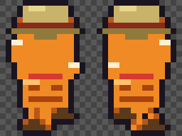 | [`pawfall.colby-climb`](assets/pawfall.colby-climb/asset.json) | colby_climb | 16x24 x2 | animated, module:colby, pawfall, pixel-art | CC0-1.0 | 1.0.0 |
| 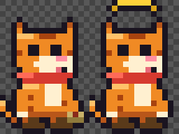 | [`pawfall.colby-dead`](assets/pawfall.colby-dead/asset.json) | colby_dead | 16x24 x2 | animated, module:colby, pawfall, pixel-art | CC0-1.0 | 1.0.0 |
| 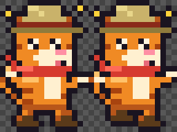 | [`pawfall.colby-hurt`](assets/pawfall.colby-hurt/asset.json) | colby_hurt | 16x24 x2 | animated, module:colby, pawfall, pixel-art | CC0-1.0 | 1.0.0 |
| 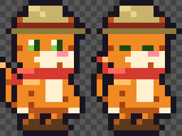 | [`pawfall.colby-idle`](assets/pawfall.colby-idle/asset.json) | colby_idle | 16x24 x2 | animated, module:colby, pawfall, pixel-art | CC0-1.0 | 1.0.0 |
| 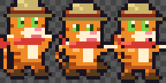 | [`pawfall.colby-jump`](assets/pawfall.colby-jump/asset.json) | colby_jump | 16x24 x3 | animated, module:colby, pawfall, pixel-art | CC0-1.0 | 1.0.0 |
|  | [`pawfall.colby-life`](assets/pawfall.colby-life/asset.json) | colby_life | 8x8 | module:colby, pawfall, pixel-art | CC0-1.0 | 1.0.0 |
| 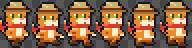 | [`pawfall.colby-run`](assets/pawfall.colby-run/asset.json) | colby_run | 16x24 x6 | animated, module:colby, pawfall, pixel-art | CC0-1.0 | 1.0.0 |
| 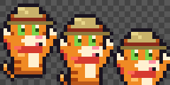 | [`pawfall.colby-sink`](assets/pawfall.colby-sink/asset.json) | colby_sink | 16x24 x3 | animated, module:colby, pawfall, pixel-art | CC0-1.0 | 1.0.0 |
| 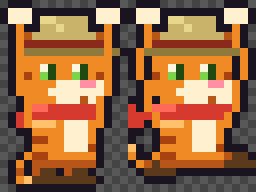 | [`pawfall.colby-swing`](assets/pawfall.colby-swing/asset.json) | colby_swing | 16x24 x2 | animated, module:colby, pawfall, pixel-art | CC0-1.0 | 1.0.0 |
| 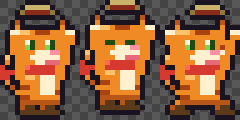 | [`pawfall.colby-win`](assets/pawfall.colby-win/asset.json) | colby_win | 16x24 x3 | animated, module:colby, pawfall, pixel-art | CC0-1.0 | 1.0.0 |
| 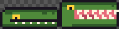 | [`pawfall.croc`](assets/pawfall.croc/asset.json) | croc | 24x12 x2 | animated, module:critters, pawfall, pixel-art | CC0-1.0 | 1.0.0 |
| 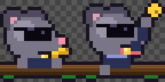 | [`pawfall.pete-branch`](assets/pawfall.pete-branch/asset.json) | pete_branch | 24x24 x2 | animated, module:colby, pawfall, pixel-art | CC0-1.0 | 1.0.0 |
| 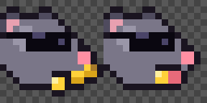 | [`pawfall.pete-head`](assets/pawfall.pete-head/asset.json) | pete_head | 16x16 x2 | animated, module:colby, pawfall, pixel-art | CC0-1.0 | 1.0.0 |
| 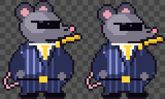 | [`pawfall.pete-idle`](assets/pawfall.pete-idle/asset.json) | pete_idle | 40x48 x2 | animated, module:colby, pawfall, pixel-art | CC0-1.0 | 1.0.0 |
| 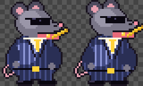 | [`pawfall.pete-laugh`](assets/pawfall.pete-laugh/asset.json) | pete_laugh | 40x48 x2 | animated, module:colby, pawfall, pixel-art | CC0-1.0 | 1.0.0 |
| 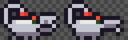 | [`pawfall.scorpion`](assets/pawfall.scorpion/asset.json) | scorpion | 16x10 x2 | animated, module:critters, pawfall, pixel-art | CC0-1.0 | 1.0.0 |
| 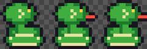 | [`pawfall.snake`](assets/pawfall.snake/asset.json) | snake | 16x16 x3 | animated, module:critters, pawfall, pixel-art | CC0-1.0 | 1.0.0 |

## fx

| Preview | Id | Name | Size | Tags | License | Version |
|---|---|---|---|---|---|---|
| 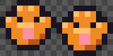 | [`pawfall.cursor-paw`](assets/pawfall.cursor-paw/asset.json) | cursor_paw | 10x10 x2 | animated, module:fx, pawfall, pixel-art | CC0-1.0 | 1.0.0 |
|  | [`pawfall.fx-bubble`](assets/pawfall.fx-bubble/asset.json) | fx_bubble | 4x4 x2 | animated, module:fx, pawfall, pixel-art | CC0-1.0 | 1.0.0 |
| 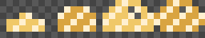 | [`pawfall.fx-dust`](assets/pawfall.fx-dust/asset.json) | fx_dust | 8x6 x4 | animated, module:fx, pawfall, pixel-art | CC0-1.0 | 1.0.0 |
| 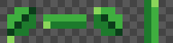 | [`pawfall.fx-leaf`](assets/pawfall.fx-leaf/asset.json) | fx_leaf | 6x6 x4 | animated, module:fx, pawfall, pixel-art | CC0-1.0 | 1.0.0 |
| 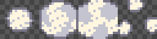 | [`pawfall.fx-poof`](assets/pawfall.fx-poof/asset.json) | fx_poof | 16x16 x4 | animated, module:fx, pawfall, pixel-art | CC0-1.0 | 1.0.0 |
| 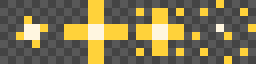 | [`pawfall.fx-sparkle`](assets/pawfall.fx-sparkle/asset.json) | fx_sparkle | 8x8 x4 | animated, module:fx, pawfall, pixel-art | CC0-1.0 | 1.0.0 |
| 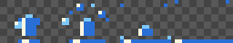 | [`pawfall.fx-splash`](assets/pawfall.fx-splash/asset.json) | fx_splash | 16x12 x4 | animated, module:fx, pawfall, pixel-art | CC0-1.0 | 1.0.0 |
| 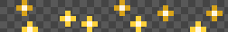 | [`pawfall.fx-stars`](assets/pawfall.fx-stars/asset.json) | fx_stars | 14x6 x3 | animated, module:fx, pawfall, pixel-art | CC0-1.0 | 1.0.0 |
| 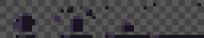 | [`pawfall.fx-tarsplat`](assets/pawfall.fx-tarsplat/asset.json) | fx_tarsplat | 16x12 x4 | animated, module:fx, pawfall, pixel-art | CC0-1.0 | 1.0.0 |
| 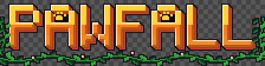 | [`pawfall.logo`](assets/pawfall.logo/asset.json) | logo | 224x56 | module:fx, pawfall, pixel-art | CC0-1.0 | 1.0.0 |
| 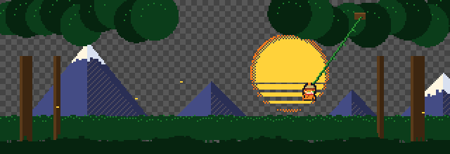 | [`pawfall.title-scene`](assets/pawfall.title-scene/asset.json) | title_scene | 320x110 | module:fx, pawfall, pixel-art | CC0-1.0 | 1.0.0 |
| 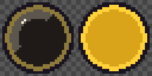 | [`pawfall.touch-btn`](assets/pawfall.touch-btn/asset.json) | touch_btn | 32x32 x2 | animated, module:fx, pawfall, pixel-art | CC0-1.0 | 1.0.0 |

## sfx

| Preview | Id | Name | Size | Tags | License | Version |
|---|---|---|---|---|---|---|
|  | [`pawfall.sfx-brick-bump`](assets/pawfall.sfx-brick-bump/asset.json) | brick_bump | 0.12 s | chiptune, pawfall, procedural, sfx | CC0-1.0 | 1.0.0 |
|  | [`pawfall.sfx-croc-snap`](assets/pawfall.sfx-croc-snap/asset.json) | croc_snap | 0.15 s | chiptune, pawfall, procedural, sfx | CC0-1.0 | 1.0.0 |
|  | [`pawfall.sfx-die`](assets/pawfall.sfx-die/asset.json) | die | 0.82 s | chiptune, pawfall, procedural, sfx | CC0-1.0 | 1.0.0 |
|  | [`pawfall.sfx-fire-crackle`](assets/pawfall.sfx-fire-crackle/asset.json) | fire_crackle | 0.57 s | chiptune, pawfall, procedural, sfx | CC0-1.0 | 1.0.0 |
|  | [`pawfall.sfx-gameover`](assets/pawfall.sfx-gameover/asset.json) | gameover | 1.12 s | chiptune, pawfall, procedural, sfx | CC0-1.0 | 1.0.0 |
|  | [`pawfall.sfx-jump`](assets/pawfall.sfx-jump/asset.json) | jump | 0.18 s | chiptune, pawfall, procedural, sfx | CC0-1.0 | 1.0.0 |
|  | [`pawfall.sfx-ladder`](assets/pawfall.sfx-ladder/asset.json) | ladder | 0.21 s | chiptune, pawfall, procedural, sfx | CC0-1.0 | 1.0.0 |
|  | [`pawfall.sfx-land`](assets/pawfall.sfx-land/asset.json) | land | 0.16 s | chiptune, pawfall, procedural, sfx | CC0-1.0 | 1.0.0 |
|  | [`pawfall.sfx-log-hit`](assets/pawfall.sfx-log-hit/asset.json) | log_hit | 0.20 s | chiptune, pawfall, procedural, sfx | CC0-1.0 | 1.0.0 |
|  | [`pawfall.sfx-menu-move`](assets/pawfall.sfx-menu-move/asset.json) | menu_move | 0.06 s | chiptune, pawfall, procedural, sfx | CC0-1.0 | 1.0.0 |
|  | [`pawfall.sfx-menu-select`](assets/pawfall.sfx-menu-select/asset.json) | menu_select | 0.21 s | chiptune, pawfall, procedural, sfx | CC0-1.0 | 1.0.0 |
|  | [`pawfall.sfx-oneup`](assets/pawfall.sfx-oneup/asset.json) | oneup | 0.68 s | chiptune, pawfall, procedural, sfx | CC0-1.0 | 1.0.0 |
|  | [`pawfall.sfx-pete-laugh`](assets/pawfall.sfx-pete-laugh/asset.json) | pete_laugh | 0.82 s | chiptune, pawfall, procedural, sfx | CC0-1.0 | 1.0.0 |
|  | [`pawfall.sfx-quicksand`](assets/pawfall.sfx-quicksand/asset.json) | quicksand | 0.62 s | chiptune, pawfall, procedural, sfx | CC0-1.0 | 1.0.0 |
|  | [`pawfall.sfx-respawn`](assets/pawfall.sfx-respawn/asset.json) | respawn | 0.30 s | chiptune, pawfall, procedural, sfx | CC0-1.0 | 1.0.0 |
|  | [`pawfall.sfx-scorpion`](assets/pawfall.sfx-scorpion/asset.json) | scorpion | 0.24 s | chiptune, pawfall, procedural, sfx | CC0-1.0 | 1.0.0 |
|  | [`pawfall.sfx-screen-flip`](assets/pawfall.sfx-screen-flip/asset.json) | screen_flip | 0.32 s | chiptune, pawfall, procedural, sfx | CC0-1.0 | 1.0.0 |
|  | [`pawfall.sfx-snake-hiss`](assets/pawfall.sfx-snake-hiss/asset.json) | snake_hiss | 0.62 s | chiptune, pawfall, procedural, sfx | CC0-1.0 | 1.0.0 |
|  | [`pawfall.sfx-splash`](assets/pawfall.sfx-splash/asset.json) | splash | 0.47 s | chiptune, pawfall, procedural, sfx | CC0-1.0 | 1.0.0 |
|  | [`pawfall.sfx-step`](assets/pawfall.sfx-step/asset.json) | step | 0.07 s | chiptune, pawfall, procedural, sfx | CC0-1.0 | 1.0.0 |
|  | [`pawfall.sfx-swing-grab`](assets/pawfall.sfx-swing-grab/asset.json) | swing_grab | 0.22 s | chiptune, pawfall, procedural, sfx | CC0-1.0 | 1.0.0 |
|  | [`pawfall.sfx-swing-release`](assets/pawfall.sfx-swing-release/asset.json) | swing_release | 0.27 s | chiptune, pawfall, procedural, sfx | CC0-1.0 | 1.0.0 |
|  | [`pawfall.sfx-tar-glug`](assets/pawfall.sfx-tar-glug/asset.json) | tar_glug | 0.37 s | chiptune, pawfall, procedural, sfx | CC0-1.0 | 1.0.0 |
|  | [`pawfall.sfx-tick-low`](assets/pawfall.sfx-tick-low/asset.json) | tick_low | 0.04 s | chiptune, pawfall, procedural, sfx | CC0-1.0 | 1.0.0 |
|  | [`pawfall.sfx-treasure`](assets/pawfall.sfx-treasure/asset.json) | treasure | 0.52 s | chiptune, pawfall, procedural, sfx | CC0-1.0 | 1.0.0 |
|  | [`pawfall.sfx-treasure-big`](assets/pawfall.sfx-treasure-big/asset.json) | treasure_big | 1.12 s | chiptune, pawfall, procedural, sfx | CC0-1.0 | 1.0.0 |
|  | [`pawfall.sfx-tunnel-drop`](assets/pawfall.sfx-tunnel-drop/asset.json) | tunnel_drop | 0.52 s | chiptune, pawfall, procedural, sfx | CC0-1.0 | 1.0.0 |
|  | [`pawfall.sfx-victory`](assets/pawfall.sfx-victory/asset.json) | victory | 2.04 s | chiptune, pawfall, procedural, sfx | CC0-1.0 | 1.0.0 |

## song

| Preview | Id | Name | Size | Tags | License | Version |
|---|---|---|---|---|---|---|
|  | [`pawfall.song-dusk`](assets/pawfall.song-dusk/asset.json) | dusk | 43.64 s | chiptune, loop, music, pawfall, procedural | CC0-1.0 | 1.0.0 |
|  | [`pawfall.song-gameover`](assets/pawfall.song-gameover/asset.json) | gameover | 5.40 s | chiptune, music, pawfall, procedural, sting | CC0-1.0 | 1.0.0 |
| 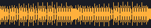 | [`pawfall.song-jungle`](assets/pawfall.song-jungle/asset.json) | jungle | 29.09 s | chiptune, loop, music, pawfall, procedural | CC0-1.0 | 1.0.0 |
|  | [`pawfall.song-title`](assets/pawfall.song-title/asset.json) | title | 15.24 s | chiptune, loop, music, pawfall, procedural | CC0-1.0 | 1.0.0 |
|  | [`pawfall.song-underground`](assets/pawfall.song-underground/asset.json) | underground | 22.86 s | chiptune, loop, music, pawfall, procedural | CC0-1.0 | 1.0.0 |
|  | [`pawfall.song-victory`](assets/pawfall.song-victory/asset.json) | victory | 7.27 s | chiptune, music, pawfall, procedural, sting | CC0-1.0 | 1.0.0 |

## sprite

| Preview | Id | Name | Size | Tags | License | Version |
|---|---|---|---|---|---|---|
| 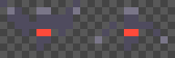 | [`pawfall.bat`](assets/pawfall.bat/asset.json) | bat | 12x8 x2 | animated, module:world, pawfall, pixel-art | CC0-1.0 | 1.0.0 |
| 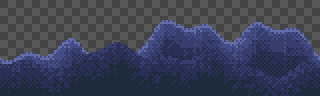 | [`pawfall.bg-mountains`](assets/pawfall.bg-mountains/asset.json) | bg_mountains | 160x48 | module:world, pawfall, pixel-art | CC0-1.0 | 1.0.0 |
| 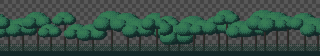 | [`pawfall.bg-trees`](assets/pawfall.bg-trees/asset.json) | bg_trees | 160x56 x2 | animated, module:world, pawfall, pixel-art | CC0-1.0 | 1.0.0 |
| 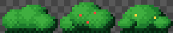 | [`pawfall.bush`](assets/pawfall.bush/asset.json) | bush | 24x14 x3 | animated, module:world, pawfall, pixel-art | CC0-1.0 | 1.0.0 |
| 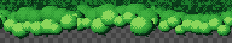 | [`pawfall.canopy`](assets/pawfall.canopy/asset.json) | canopy | 64x36 x3 | animated, module:world, pawfall, pixel-art | CC0-1.0 | 1.0.0 |
| 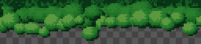 | [`pawfall.canopy-far`](assets/pawfall.canopy-far/asset.json) | canopy_far | 64x28 x2 | animated, module:world, pawfall, pixel-art | CC0-1.0 | 1.0.0 |
|  | [`pawfall.cheese`](assets/pawfall.cheese/asset.json) | cheese | 14x14 x4 | animated, module:critters, pawfall, pixel-art | CC0-1.0 | 1.0.0 |
| 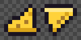 | [`pawfall.cheese-thrown`](assets/pawfall.cheese-thrown/asset.json) | cheese_thrown | 10x10 x2 | animated, module:critters, pawfall, pixel-art | CC0-1.0 | 1.0.0 |
| 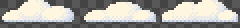 | [`pawfall.cloud`](assets/pawfall.cloud/asset.json) | cloud | 40x14 x3 | animated, module:world, pawfall, pixel-art | CC0-1.0 | 1.0.0 |
| 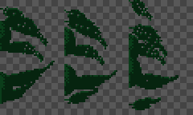 | [`pawfall.fg-leaf`](assets/pawfall.fg-leaf/asset.json) | fg_leaf | 40x72 x3 | animated, module:world, pawfall, pixel-art | CC0-1.0 | 1.0.0 |
| 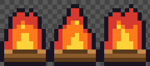 | [`pawfall.fire`](assets/pawfall.fire/asset.json) | fire | 12x16 x3 | animated, module:critters, pawfall, pixel-art | CC0-1.0 | 1.0.0 |
|  | [`pawfall.firefly`](assets/pawfall.firefly/asset.json) | firefly | 3x3 x2 | animated, module:world, pawfall, pixel-art | CC0-1.0 | 1.0.0 |
| 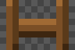 | [`pawfall.ladder`](assets/pawfall.ladder/asset.json) | ladder | 12x8 | module:world, pawfall, pixel-art | CC0-1.0 | 1.0.0 |
| 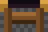 | [`pawfall.ladder-top`](assets/pawfall.ladder-top/asset.json) | ladder_top | 12x8 | module:world, pawfall, pixel-art | CC0-1.0 | 1.0.0 |
| 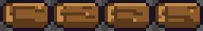 | [`pawfall.log`](assets/pawfall.log/asset.json) | log | 16x10 x4 | animated, module:critters, pawfall, pixel-art | CC0-1.0 | 1.0.0 |
| 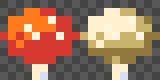 | [`pawfall.mushroom`](assets/pawfall.mushroom/asset.json) | mushroom | 10x10 x2 | animated, module:world, pawfall, pixel-art | CC0-1.0 | 1.0.0 |
| 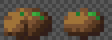 | [`pawfall.rock`](assets/pawfall.rock/asset.json) | rock | 14x10 x2 | animated, module:world, pawfall, pixel-art | CC0-1.0 | 1.0.0 |
| 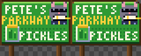 | [`pawfall.sign-pete`](assets/pawfall.sign-pete/asset.json) | sign_pete | 40x32 x2 | animated, module:world, pawfall, pixel-art | CC0-1.0 | 1.0.0 |
|  | [`pawfall.star`](assets/pawfall.star/asset.json) | star | 3x3 x2 | animated, module:world, pawfall, pixel-art | CC0-1.0 | 1.0.0 |
| 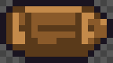 | [`pawfall.stilllog`](assets/pawfall.stilllog/asset.json) | stilllog | 18x10 | module:critters, pawfall, pixel-art | CC0-1.0 | 1.0.0 |
| 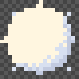 | [`pawfall.sun`](assets/pawfall.sun/asset.json) | sun | 20x20 | module:world, pawfall, pixel-art | CC0-1.0 | 1.0.0 |
| 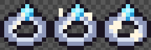 | [`pawfall.tr-collar`](assets/pawfall.tr-collar/asset.json) | tr_collar | 12x12 x3 | animated, module:critters, pawfall, pixel-art | CC0-1.0 | 1.0.0 |
| 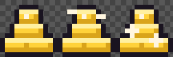 | [`pawfall.tr-gold`](assets/pawfall.tr-gold/asset.json) | tr_gold | 12x12 x3 | animated, module:critters, pawfall, pixel-art | CC0-1.0 | 1.0.0 |
| 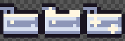 | [`pawfall.tr-sardine`](assets/pawfall.tr-sardine/asset.json) | tr_sardine | 12x12 x3 | animated, module:critters, pawfall, pixel-art | CC0-1.0 | 1.0.0 |
| 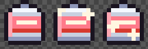 | [`pawfall.tr-tuna`](assets/pawfall.tr-tuna/asset.json) | tr_tuna | 12x12 x3 | animated, module:critters, pawfall, pixel-art | CC0-1.0 | 1.0.0 |
|  | [`pawfall.trunk`](assets/pawfall.trunk/asset.json) | trunk | 14x64 x3 | animated, module:world, pawfall, pixel-art | CC0-1.0 | 1.0.0 |
|  | [`pawfall.vine-knot`](assets/pawfall.vine-knot/asset.json) | vine_knot | 6x6 | module:world, pawfall, pixel-art | CC0-1.0 | 1.0.0 |
|  | [`pawfall.vine-pivot`](assets/pawfall.vine-pivot/asset.json) | vine_pivot | 12x10 | module:world, pawfall, pixel-art | CC0-1.0 | 1.0.0 |

## tileset

| Preview | Id | Name | Size | Tags | License | Version |
|---|---|---|---|---|---|---|
|  | [`pawfall.pit-depth`](assets/pawfall.pit-depth/asset.json) | pit_depth | 16x16 | module:world, pawfall, pixel-art | CC0-1.0 | 1.0.0 |
|  | [`pawfall.tile-brick`](assets/pawfall.tile-brick/asset.json) | tile_brick | 16x8 | module:world, pawfall, pixel-art | CC0-1.0 | 1.0.0 |
|  | [`pawfall.tile-ceil`](assets/pawfall.tile-ceil/asset.json) | tile_ceil | 16x10 x2 | animated, module:world, pawfall, pixel-art | CC0-1.0 | 1.0.0 |
|  | [`pawfall.tile-dirt`](assets/pawfall.tile-dirt/asset.json) | tile_dirt | 16x16 x2 | animated, module:world, pawfall, pixel-art | CC0-1.0 | 1.0.0 |
|  | [`pawfall.tile-path`](assets/pawfall.tile-path/asset.json) | tile_path | 16x10 x2 | animated, module:world, pawfall, pixel-art | CC0-1.0 | 1.0.0 |
|  | [`pawfall.tile-quick`](assets/pawfall.tile-quick/asset.json) | tile_quick | 16x10 x3 | animated, module:world, pawfall, pixel-art | CC0-1.0 | 1.0.0 |
|  | [`pawfall.tile-tar`](assets/pawfall.tile-tar/asset.json) | tile_tar | 16x10 x3 | animated, module:world, pawfall, pixel-art | CC0-1.0 | 1.0.0 |
|  | [`pawfall.tile-tunnel`](assets/pawfall.tile-tunnel/asset.json) | tile_tunnel | 16x16 | module:world, pawfall, pixel-art | CC0-1.0 | 1.0.0 |
|  | [`pawfall.tile-water`](assets/pawfall.tile-water/asset.json) | tile_water | 16x10 x3 | animated, module:world, pawfall, pixel-art | CC0-1.0 | 1.0.0 |

